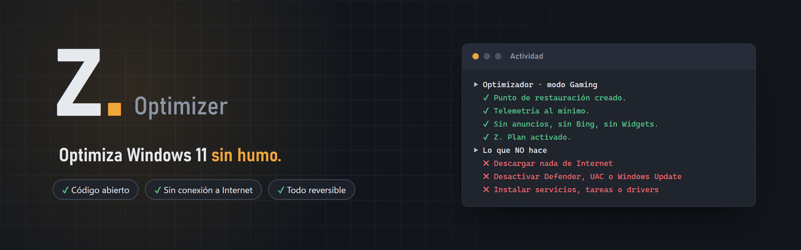
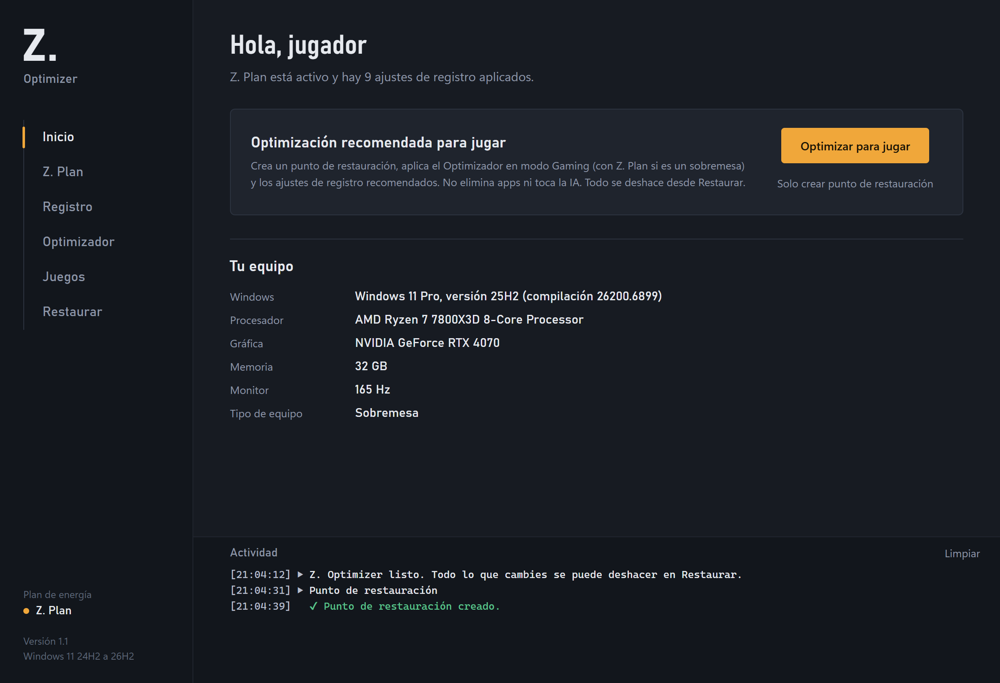
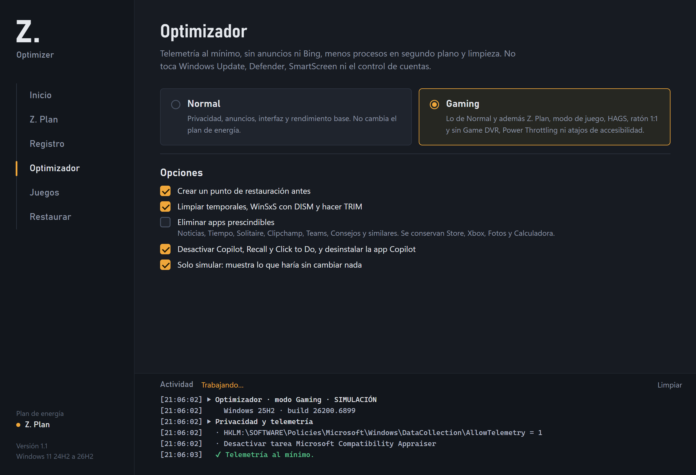
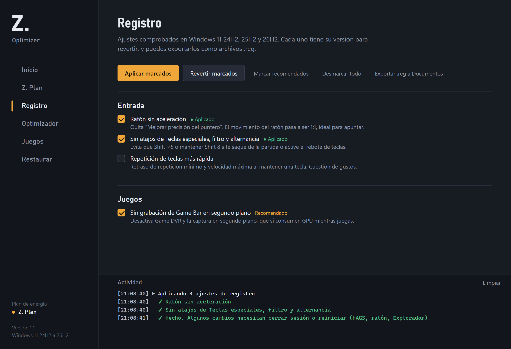
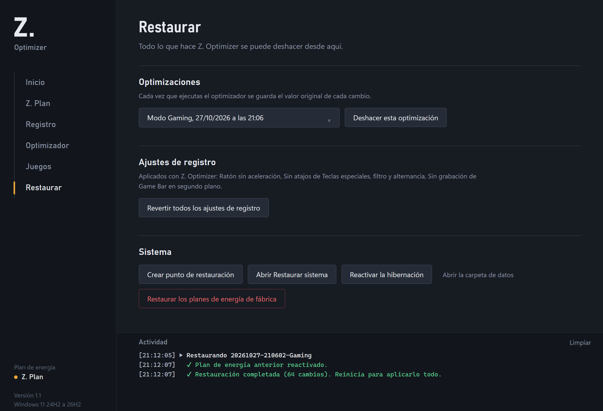

<p align="center">
  
</p>

<p align="center">
  
  
  
  
</p>

<p align="center">
  <b>Un optimizador de Windows 11 que puedes leer entero antes de ejecutarlo.</b><br>
  Un solo script de PowerShell, sin binarios, sin descargas y con un botón para deshacerlo todo.
</p>

<p align="center">
  <a href="#instalación">Instalación</a> ·
  <a href="#qué-hace">Qué hace</a> ·
  <a href="#qué-no-hace">Qué no hace</a> ·
  <a href="#módulos">Módulos</a> ·
  <a href="#audítalo-tú-mismo">Audítalo tú mismo</a> ·
  <a href="README.en.md">English</a>
</p>

---

## Por qué existe

El mundo de los "optimizadores de PC" está lleno de humo: programas de pago cerrados que prometen +200 FPS, `.exe` sin firmar que piden administrador, "packs de tweaks" que desactivan Defender y Windows Update, y en los peores casos **backdoors, mineros y botnets** escondidos detrás de un botón de *Boost*.

Z. Optimizer es lo contrario:

- **Código abierto y legible.** Todo el programa es [`Z-Optimizer.ps1`](Z-Optimizer.ps1). No hay `.exe`, ni DLLs, ni código ofuscado ni Base64.
- **Cero conexiones de red.** No descarga nada, no "comprueba actualizaciones", no envía estadísticas. Puedes ejecutarlo sin Internet.
- **Todo es reversible.** Cada valor que cambia se guarda antes en un *journal* y se puede deshacer desde la pestaña **Restaurar**. Además crea un punto de restauración del sistema.
- **Sin promesas mágicas.** Cada ajuste explica qué hace y, cuando el efecto es pequeño o discutido, lo dice.

## Capturas

<table>
  <tr>
    <td width="50%"></td>
    <td width="50%"></td>
  </tr>
  <tr>
    <td align="center"><sub><b>Inicio</b>: resumen del equipo y optimización en un clic</sub></td>
    <td align="center"><sub><b>Optimizador</b>: modo Normal o Gaming, con simulación</sub></td>
  </tr>
  <tr>
    <td width="50%"></td>
    <td width="50%"></td>
  </tr>
  <tr>
    <td align="center"><sub><b>Registro</b>: ajustes .reg con su versión para revertir</sub></td>
    <td align="center"><sub><b>Restaurar</b>: deshace cualquier optimización</sub></td>
  </tr>
</table>

<sub>Las capturas son una recreación de la interfaz real con datos de ejemplo (sus fuentes están en <a href="assets/src">assets/src</a>).</sub>

## Instalación

1. Descarga el repositorio: **Code → Download ZIP** (o la última versión en *Releases*) y descomprímelo.
2. *(Recomendado)* Abre `Z-Optimizer.ps1` con el Bloc de notas o VS Code y échale un vistazo.
3. Haz doble clic en **`Iniciar Z. Optimizer.bat`**. Windows pedirá permisos de administrador.

> [!NOTE]
> El `.bat` solo desbloquea los archivos descargados (`Unblock-File`) y lanza el script con `-ExecutionPolicy Bypass` **para ese proceso**. No cambia la directiva de ejecución de tu sistema.

> [!TIP]
> Antes de aplicar nada, marca **"Solo simular"** en el Optimizador: verás en la consola cada cambio que haría, sin tocar el sistema.

**Requisitos:** Windows 11 (24H2, 25H2 o 26H2) · Windows PowerShell 5.1 (viene con Windows) · cuenta de administrador.

## Qué hace

| Área | Cambios |
|---|---|
| **Privacidad** | Telemetría al mínimo permitido, sin ID de publicidad, sin historial de actividad, servicios `DiagTrack` y `dmwappushservice` desactivados, tareas de CEIP/Appraiser desactivadas |
| **Interfaz** | Sin anuncios ni apps sugeridas, sin Bing en la búsqueda de Inicio, sin Widgets, extensiones de archivo visibles |
| **IA** *(opcional)* | Copilot, Recall y Click to Do desactivados mediante las directivas oficiales |
| **Rendimiento** | Menos animaciones, sin retraso de apps de inicio, Edge sin segundo plano, Sensor de almacenamiento |
| **Gaming** | Modo de juego, HAGS, sin Game DVR, sin Power Throttling, ratón 1:1, sin atajos de accesibilidad que te sacan del juego, plan de energía **Z. Plan** |
| **Limpieza** *(opcional)* | Temporales, caché de Optimización de distribución, `DISM /StartComponentCleanup` y TRIM |
| **Bloatware** *(opcional)* | Noticias, Tiempo, Solitaire, Clipchamp, Teams, Consejos… Conserva Store, Xbox, Fotos y Calculadora |

## Qué NO hace

- ❌ No se conecta a Internet ni descarga scripts (nada de `irm … | iex`).
- ❌ No desactiva **Windows Defender**, **SmartScreen**, el **Control de cuentas (UAC)** ni **Windows Update**.
- ❌ No instala servicios, tareas programadas, drivers ni programas.
- ❌ No desactiva los C-states ni las mitigaciones de Spectre/Meltdown.
- ❌ No toca tu cuenta, tus contraseñas ni tus archivos personales.

## Módulos

<details>
<summary><b>Z. Plan</b> — plan de energía propio</summary>

Duplica *Máximo rendimiento* (o *Alto rendimiento* / *Equilibrado* si el equipo no lo permite) y ajusta:

- CPU al 100 % mínimo y máximo, sin aparcamiento de núcleos (también E-cores en Intel híbridos)
- Turbo agresivo y EPP a rendimiento
- PCI Express sin ASPM, USB sin suspensión selectiva, el disco no se apaga
- Opcional: Wi-Fi a máximo rendimiento, sin suspensión, sin hibernación

Deja como están los C-states, la contraseña al despertar y los valores con batería en portátiles. En portátiles, el modo Gaming **no** cambia el plan de energía.
</details>

<details>
<summary><b>Registro</b> — 20 ajustes <code>.reg</code> verificados</summary>

Cada ajuste tiene su versión para revertir y se puede **exportar como archivo `.reg`** a Documentos para inspeccionarlo o usarlo sin el programa.

| Categoría | Ajustes |
|---|---|
| Entrada | Ratón sin aceleración · Sin atajos de Teclas especiales · Repetición de teclas rápida |
| Juegos | Sin Game DVR · Modo de juego · HAGS · Desactivar MPO *(solo si tienes parpadeos)* |
| Rendimiento | Sin Power Throttling · `Win32PrioritySeparation` · Sin limitación de red multimedia · Sin retraso de inicio · Menos animaciones · Edge sin segundo plano |
| Sistema | Windows Update no instala drivers |
| Interfaz | Búsqueda sin Bing · Sin Widgets · Sin anuncios · Sin Copilot/Recall · Extensiones visibles · Menú contextual clásico |
</details>

<details>
<summary><b>Optimizador</b> — modos Normal y Gaming</summary>

- **Normal:** privacidad, anuncios, interfaz y rendimiento base.
- **Gaming:** lo anterior + Z. Plan, modo de juego, HAGS, ratón 1:1, sin Game DVR ni Power Throttling.
- **Modo agresivo** *(opcional)*: sin transparencias, sin apps en segundo plano, sin hibernación, `DISM /ResetBase`.
- **Solo simular:** muestra cada cambio sin aplicarlo.
</details>

<details>
<summary><b>Juegos</b> — perfiles de Fortnite</summary>

Modifica solo las claves necesarias de `GameUserSettings.ini` (sensibilidad, controles y audio se conservan) y guarda una copia antes de cada cambio.

| Perfil | Para quién |
|---|---|
| Competitivo | Todo al mínimo, pantalla completa, Reflex + Boost |
| Máxima visibilidad | Construcciones lejanas antes, texturas altas (6 GB+ de VRAM) |
| Sin bordes para streaming | Alt+Tab instantáneo y captura cómoda con OBS |
| PC modesto | Gráficas integradas: resolución 3D al 85 % |

También permite fijar la **GPU de alto rendimiento** para cualquier `.exe`.
</details>

<details>
<summary><b>Restaurar</b> — deshacerlo todo</summary>

- Deshacer cualquier optimización desde su *journal* (registro, servicios, tareas, plan de energía, hibernación)
- Revertir todos los ajustes de registro aplicados
- Crear un punto de restauración o abrir *Restaurar sistema*
- Restaurar los planes de energía de fábrica

Las apps eliminadas no se reinstalan automáticamente: se pueden volver a instalar desde Microsoft Store.
</details>

## Dónde guarda sus datos

| Ruta | Contenido |
|---|---|
| `%ProgramData%\ZOptimizer\journals\` | Valor original de cada cambio, por ejecución |
| `%ProgramData%\ZOptimizer\reg-applied.txt` | Qué ajustes de registro están aplicados |
| `%ProgramData%\ZOptimizer\backups\fortnite\` | Copias de `GameUserSettings.ini` |
| `Documentos\Z. Optimizer\` | Archivos `.reg` exportados (solo si los exportas) |

Nada sale de tu equipo.

## Audítalo tú mismo

No te fíes de nosotros: compruébalo. Desde PowerShell, en la carpeta del proyecto:

```powershell
# ¿Alguna conexión de red, descarga o ejecución de código dinámico?
Select-String -Path .\Z-Optimizer.ps1 -Pattern 'Invoke-WebRequest|Invoke-RestMethod|WebClient|HttpClient|Net\.Sockets|DownloadString|DownloadFile|Invoke-Expression|\biex\b|FromBase64String|EncodedCommand|Start-BitsTransfer'
# Resultado esperado: nada.

# Hash del archivo, para compararlo con el publicado en la Release
Get-FileHash .\Z-Optimizer.ps1 -Algorithm SHA256
```

Si encuentras algo sospechoso o un ajuste que hace daño, abre un *issue*. Consulta [SECURITY.md](SECURITY.md).

## Preguntas frecuentes

**¿Cuántos FPS voy a ganar?**
Depende del equipo y probablemente menos de lo que prometen otros. Lo que más reduce el input lag es Reflex/Anti-Lag, FPS estables, pantalla completa y buena red. Este programa se ocupa de quitar el ruido de fondo de Windows. Mide con LatencyMon o CapFrameX antes y después.

**¿Mi antivirus lo marca?**
Algunos antivirus desconfían de cualquier script que pida administrador y toque el registro. Por eso el código es abierto: léelo o pásalo por VirusTotal.

**¿Funciona en Windows 10?**
No está pensado para Windows 10; muchas opciones no se aplicarán.

## Contribuir

Las propuestas son bienvenidas, con una condición: cada ajuste nuevo debe estar **documentado**, ser **reversible** y no tocar la seguridad del sistema. Lee [CONTRIBUTING.md](CONTRIBUTING.md).

## Licencia

[MIT](LICENSE). Úsalo, estúdialo y modifícalo libremente.

> [!WARNING]
> Este software modifica la configuración del sistema. Se ofrece "tal cual", sin garantías. Crea un punto de restauración antes de usarlo (el programa lo hace por ti por defecto).
